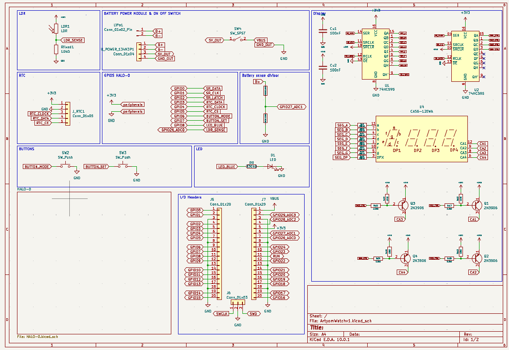
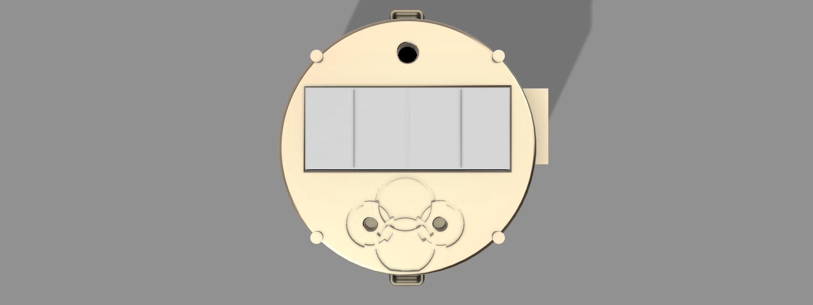
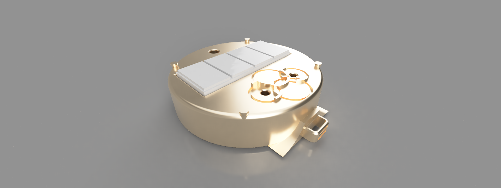
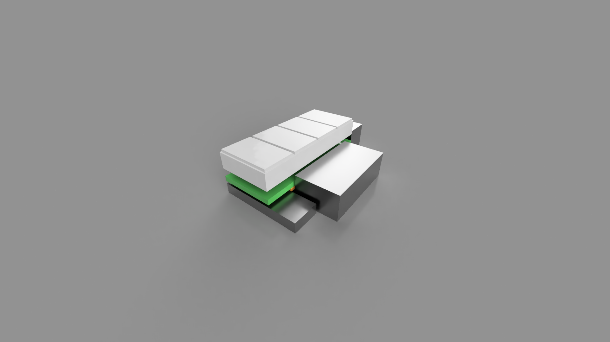

## watchywatch
WatchyWatch is a metro exodus inspired watch, mixed with some napoleonic era eastereggs. so this v1, has 2 buttons a 4 digit display a battery an LDR checker and a RTC checker, this project uses an old pcb that is in the files 
but mostly this is a perfboard project with 2 modules.

*Note for reviewer
This project doesnt use a PCB this is because shipping pcbs or dedicated components to my country takes up to 2 months, and in my country we dont really count with an electronics culture so the available components are really old or really basic. so thats why Im reusing and doing a soviet style project hahah*

## The reason behind this project
This project is born from an Idea I had for quite a while, i really enjoyed metro exodus, and I wanted to create this type of watch, to kinda prove my self "If i was in an apocalyptic world would i be able to create this type of watch"

umm turns out not really haha, but I really learned quite a lot, I learned first about PNP transistors, i mean I had the idea but with this project I truly understood why they work, the same with how you have to calculate resistor values, and well of course I learned to read in deep datasheets. Im still kinda sad I couldnt make my own pcb and not make this 1.5cm block but yeahh 

## Schematic Overview

  

## 3D View and render

  

  

  

## Special thanks
Thanks to fallen and [Hack Club](https://hackclub.com) for this program :D

## You might also like
Check out some of my other projects:
- [BerserkMod](https://github.com/Cocotrilito/berserkmod) - A Berserk themed Minecraft mod
- [BlurryProject](https://github.com/Cocotrilito/BlurryProject) - A tool to blur faces or objects super quick

